# What Actually Matters at 10M Parameters?

**A preregistered ablation study of small transformer language models**

Vraj Detroja

*October 2026. Code, configs, frozen-data hashes, a summary row for every run
(`results/all_runs.csv`), and the preregistrations are in this repository. Every number
below regenerates from that file with the scripts in `analysis/`.*

---

## Abstract

I trained 196 small transformer language models (1.2M to 18.9M non-embedding parameters,
mostly a 10.6M-parameter, 6-layer unit model) on FineWeb-Edu. I compared 24 architecture,
initialization, schedule, tokenizer, and optimizer variants against a vanilla GPT-2-style
baseline, under matched parameters and tokens. Every variant got its own learning-rate sweep
and three seeds. Every prediction was preregistered before its runs.

The baseline's seed noise is σ = 0.0036 nats, and 78% of it is GPU kernel non-determinism:
the same seed run twice differs almost as much as two seeds. Against that floor:
- **Clear wins:** RoPE (−0.084 nats), ALiBi (−0.059), the WSD schedule (−0.036), Muon (−0.115),
  and a 16k vocabulary (−0.017 bits per byte).
- **Losses:** NoPE, fixed sinusoids, post-LN, standard initialization, and every depth other
  than 6 layers.
- **Small or null:** gated FFNs, RMSNorm, linear decay.

RoPE's advantage holds at every scale but shrinks steadily, from −0.34 at 1.2M parameters to
−0.07 at 18.9M. **32 of my 59 numeric predictions held**, and the misses mostly
underestimated effect sizes.

---

## 1. Why this study

Almost every "I trained a GPT" project reports one run per idea. Narang et al. (2021) showed
what happens when proposed transformer modifications are tested under controlled conditions:
most do not transfer. This is a small-scale version of that test with three additions:
1. **A measured noise floor**, including the part caused by non-deterministic GPU kernels.
2. **Per-variant LR tuning**, so every comparison is optimum to optimum.
3. **Preregistration**, so I cannot quietly move the goalposts after seeing a result. Each
   prediction was committed before the runs that tested it.

## 2. Setup

**Unit model.**
- 6 layers, d = 384, 6 heads of 64, context 512, tied embeddings.
- GPT-2-style pre-LN LayerNorm, GELU FFN at 4×, learned absolute positions, no biases.
- 10.62M non-embedding parameters, 13.96M total.
- I chose the baseline to be vanilla on purpose, so each variant is one change away from a
  reference point the literature knows.

**Training.**
- 212M tokens, i.e. 20 per non-embedding parameter, as 1,620 steps of 131,072 tokens.
- AdamW (β = 0.9/0.95, weight decay 0.1, clip 1.0), 200 warmup steps, cosine to 10% of peak.
- bf16 autocast with fp32 master weights, `torch.compile`.

**Data.** The first two shards of FineWeb-Edu's 10B-token sample, frozen once and read in a
fixed order that depends only on a data seed, never the model seed. Documents go to splits by
a hash of their content, so duplicates cannot straddle train and validation:
- **val_iid:** 8,322 documents, 40,003,039 bytes; 10.2M tokens at 8k vocab.
- **val_long:** 500 documents ≥ 24 KB each, for length extrapolation.
- **val_ood:** 8 MB of Python code (codeparrot-clean-valid).

The evaluation text is byte-identical for every tokenizer.

**Tokenizer.**
- My own byte-level BPE, with the GPT-4 pre-tokenization regex, trained on 500 MB.
- An incremental trainer (pair counts plus a lazily invalidated heap) reproduces the naive
  trainer's merges exactly. It learns all 32,511 merges in 147 s with 1.9 GB of RAM.
- One run gives every vocabulary size, because BPE's merge sequence is a prefix property.
- Compression is 2.98 / 3.45 / 3.91 / 4.30 / 4.60 bytes per token at 2k / 4k / 8k / 16k / 32k.

**Compute.**
- A unit run is 2.06e16 training FLOPs. The textbook 6ND undercounts this by 34% at this
  width, because the unembedding and attention terms are not small when d = 384.
- On an NVIDIA RTX 4090 (PyTorch 2.10, `torch.compile`) the baseline trains at about 935k
  tokens/s, **55% MFU**.
- Two variants of the card (24 GB and 48 GB) were used. Throughput was benchmarked on each,
  and wallclock comparisons are normalized by those benchmarks.

## 3. Methodology

**Noise floor first.** Before any ablation I trained the baseline with five seeds at its best
LR, plus two more runs with the *same* seed (Figure 1).
- **σ_seed = 0.0036 nats** (95% CI 0.0022–0.0104).
- **σ_kernel = 0.0028**, from three identical-seed runs: **78% of σ**.

On the 4090, identical runs are bitwise equal for two steps and then diverge, because
non-deterministic kernel reductions are amplified during warmup. "Seed 0" names a
distribution of runs, not a run.

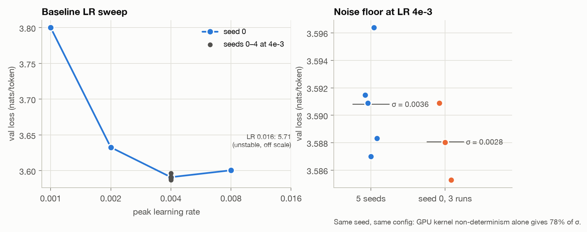
*Figure 1. Left: the baseline LR sweep (seed 0) and the five seeds at the chosen LR. Right:
five seeds against three runs of one seed.*

**Verdict rule.** An effect counts only if it clears 2σ under **two** noise estimates:
- σ_seed from the baseline, so 2σ = 0.0072.
- **σ_pooled**, the within-variant spread pooled over every variant at its best LR:
  0.0118, 42 degrees of freedom, so 2σ = 0.0236.

Clearing one but not the other is **threshold-sensitive**; clearing neither is
**inconclusive**. The second estimate matters, because noise depends on the variant
(Figure 14): standard initialization is 12× noisier than the baseline, and the deep models
4–6×. A baseline-only σ is optimistic for any configuration that is less stable than the
baseline.

**Optimum to optimum.** Every variant got its own sweep: seed 0 at LR {2e-3, 4e-3, 8e-3}
around the baseline's best, extended one step past any edge, then two more seeds at its best
(Figure 13). Choosing the LR on seed 0 could bias that seed low. But the four fresh seeds'
mean (3.5908) equals the five-seed mean (3.5908), and every variant gets the identical
procedure.

**Preregistration.** Nine preregistrations (`experiments/preregistrations/`) state the
hypothesis, a numeric prediction, the effect size that would matter, and the falsifier. Each
was committed before its runs.
Amendments are dated and were committed before the runs they affect. Section 7 lists what
changed and why.

**Matching.** Every comparison is at equal steps, which means equal tokens. Depth/width and
the optimizers are also reported at equal FLOPs and at equal wallclock. Vocabulary variants
run at equal FLOPs, with total parameters matched by depth, and are judged in **bits per
byte**: per-token loss is not comparable across tokenizers.

## 4. Results

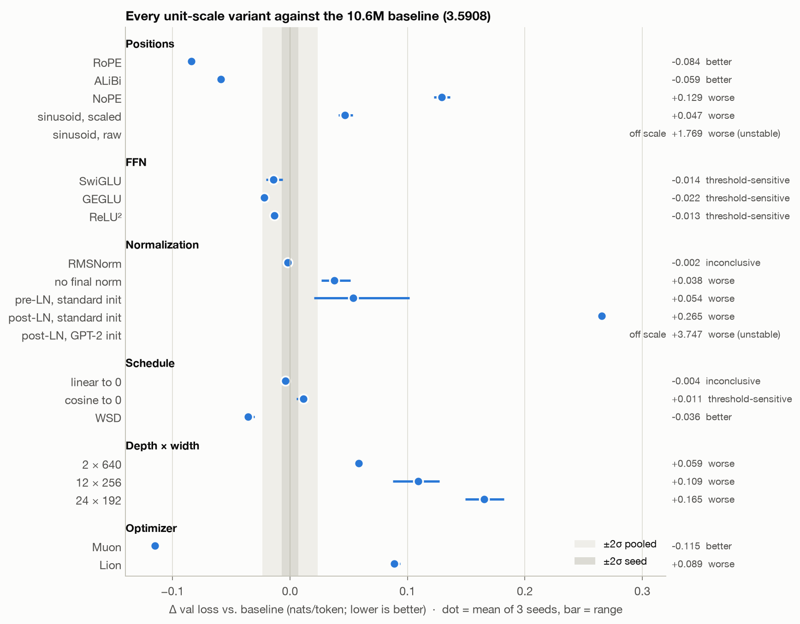
*Figure 2. Every unit-scale variant against the baseline (3.5908 nats). Dot: mean of three
seeds at the variant's own best LR; bar: range. Bands: ±2σ_seed (dark) and ±2σ_pooled (light).*

### 4.1 Positional encoding

| Variant | Δ (nats) | Verdict |
|---|---|---|
| RoPE | **−0.084** | better |
| ALiBi | **−0.059** | better |
| Sinusoid (rescaled, §7) | +0.047 | worse |
| NoPE | **+0.129** | worse |

I predicted the right *direction* for every variant except the sinusoid, and **every
magnitude was 3–5× too small**. Position handling matters far more at 10M than I expected.

**Length extrapolation** (Figures 3–4). Models train at 512 and are evaluated at up to 4,096
tokens on the same long documents.

| Variant | Rise at 4096 (vs. its own L = 512) |
|---|---|
| **ALiBi** | **−0.014** |
| Sinusoid, rescaled | +1.44 |
| RoPE | +1.52 |
| NoPE | +4.88 |

- **ALiBi alone extrapolates.** Its loss at 4,096 is slightly *below* its loss at 512.
- **RoPE and the sinusoid break** within a few hundred positions past 512.
- **NoPE degrades least at 1,024** (+0.29 against RoPE's +0.54) **but collapses furthest**
  by 4,096. For language-model loss this does not support carrying Kazemnejad et al.'s
  (2023) NoPE result over from reasoning tasks.

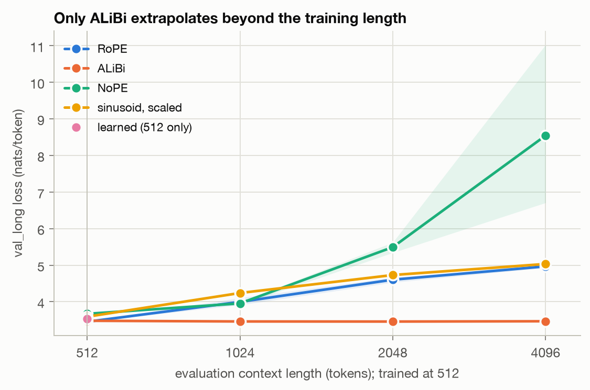
*Figure 3. val_long loss at each evaluation length; shaded: seed range.*

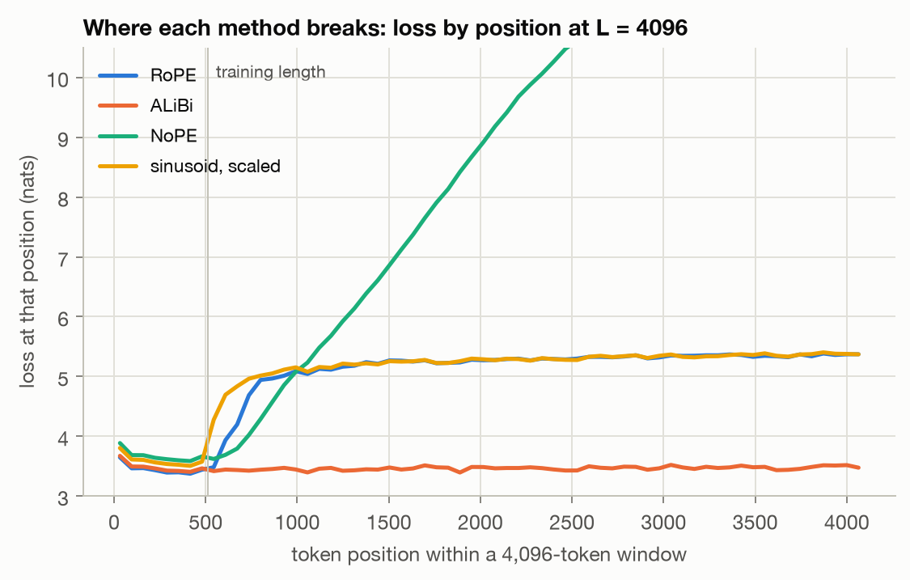
*Figure 4. Loss at each position within a 4,096-token window. ALiBi stays flat past the
training length; RoPE and the sinusoid jump within ~200 positions; NoPE climbs steadily.*

**Out of distribution, the winners lose** (Figure 15). On Python code, RoPE (+0.18 bits per
byte) and ALiBi (+0.50) are *worse* than learned positions, despite winning in distribution.
In-distribution gains here partly reflect fitting this corpus's structure. That is the
question the OOD split exists to ask, and the answer is not "better everywhere".

### 4.2 FFN activation

All FFNs have exactly matched parameters: the gated variants get hidden size 1024 instead of
1536.
- **Δ: SwiGLU −0.014, GEGLU −0.022, ReLU² −0.013.**
- All three are **threshold-sensitive**: real against seed noise, inside the
  variant-to-variant spread.
- SwiGLU's predicted range held. ReLU² did better than predicted; it is as good as the gated
  variants.
- Throughput is within 5% of GELU.

The honest summary: at 10M, every alternative FFN beats GELU by about 0.015–0.02 nats, a
small effect that does not clearly separate them from one another.

### 4.3 Normalization and initialization

- **RMSNorm** is indistinguishable from LayerNorm (−0.002, inconclusive).
- **Removing the final norm** hurts (+0.038).
- **Post-LN under GPT-2 initialization collapsed** to the unigram solution, 7.338 nats, at
  every LR and seed: uniform attention in every layer, frequency-only predictions. I first
  suspected a bug.
  - This repository's post-LN block gives *exactly* the same losses as PyTorch's
    `nn.TransformerEncoderLayer` under the same initialization (verified on a small model).
  - Under PyTorch's default initialization, both train.
  - The amended design (§7) is therefore a 2 × 2 of norm placement × initialization
    (Figure 5).

| | GPT-2 init | Standard init |
|---|---|---|
| Pre-LN | 3.591 | 3.645 (+0.054) |
| Post-LN | **7.338 (collapsed)** | 3.856 (+0.265) |

**Switching initialization moves post-LN by 3.48 nats and pre-LN by 0.05.** Post-LN's
viability depends on initialization; pre-LN's barely does. Even when it trains, post-LN is
0.21 behind pre-LN with the same init.

**The warmup demonstration** shows the textbook dependence, and where my numbers were wrong:
- Post-LN collapses at warmup 0 and 50 at both LRs tested.
- At LR 1e-3 it needs 200 warmup steps; at 2e-3 it needs 800.
- Pre-LN trains with no warmup at all, but 0.43 nats worse than with warmup.
- With 800 warmup steps, post-LN reaches 3.711, better than its best protocol run. The
  shared 200-step warmup understates post-LN.

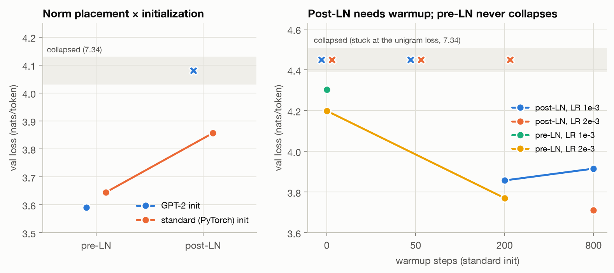
*Figure 5. Left: norm placement × initialization. Right: final loss against warmup for
post-LN and pre-LN under standard init. Collapsed runs (stuck at 7.34) are drawn in the band
at the top.*

### 4.4 Learning-rate schedule

| Schedule | Δ (nats) | Verdict |
|---|---|---|
| **WSD** (flat peak, 20% linear cooldown to 0) | **−0.036** | the only clear win |
| Linear to 0 | −0.004 | inconclusive |
| Cosine to 0 | +0.011 | slightly *worse* than stopping at 10%: threshold-sensitive |

I predicted decay to zero would help and WSD would match cosine. Both were wrong.

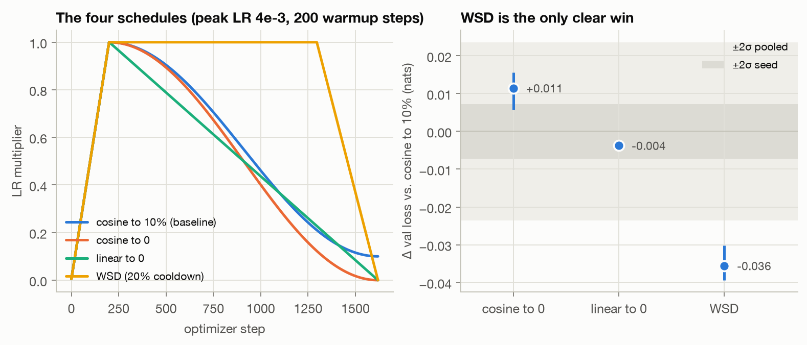
*Figure 7. Left: the four schedules. Right: Δ against cosine to 10%.*

### 4.5 Depth vs. width

At about 10.6M non-embedding parameters with heads of 64, **6 × 384 beats 2 × 640, 12 × 256,
and 24 × 192 at equal steps, equal FLOPs, and equal wallclock**, with no rank reversals
(Figure 6).

| Shape | Δ steps | Δ FLOPs | Δ wallclock |
|---|---|---|---|
| 2 × 640 | +0.059 | +0.062 | +0.041 |
| 12 × 256 | +0.109 | +0.088 | +0.124 |
| 24 × 192 | +0.165 | +0.178 | +0.278 |

- The 24-layer model is also 25% slower per token, with 43% MFU against 55%.
- Kaplan et al.'s broad optimum does not appear here.
- **Deeper models copy in context better while modelling language worse.** Induction-probe
  copy accuracy is 0.049 / 0.097 / 0.136 / 0.123 for 2 / 6 / 12 / 24 layers, against the
  loss ordering.
- **Caveat:** with d_head fixed, depth is confounded with head count (10 / 6 / 4 / 3 heads).

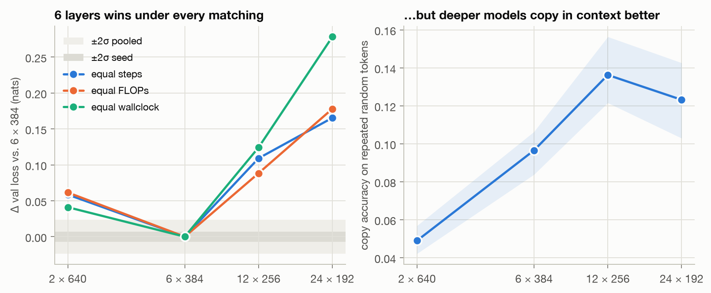
*Figure 6. Left: Δ under three matchings. Right: copy accuracy on repeated random tokens.*

### 4.6 Vocabulary size

Total parameters are matched by depth (2k and 4k: 7 layers; 8k: 6; 16k: 4), and every
tokenizer gets the same training FLOPs, so a bigger vocabulary sees more text but has a
shallower body.

| Vocab | Bits per byte | Nats per token |
|---|---|---|
| 2,048 | 1.370 | 2.838 |
| 4,096 | 1.346 | 3.230 |
| 8,192 | 1.322 | 3.591 |
| **16,384** | **1.305** | 3.905 |

**Bits per byte improves monotonically up to the largest vocabulary tested, even at 4
layers.** That falsifies my prediction, and the study design's, that the optimum is small at
this scale. Seeing 19% more text beat losing two layers.

**Per token, the ranking is exactly reversed**: 2k looks best, 16k worst. Comparing tokenizers
by per-token loss would have reached the opposite conclusion.

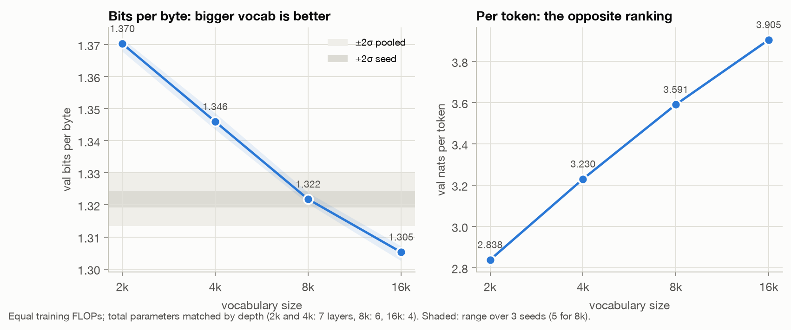
*Figure 8. Left: bits per byte, the valid comparison. Right: nats per token, the misleading one.*

### 4.7 Optimizers

**Muon** (Newton–Schulz-orthogonalized momentum on the hidden matrices, AdamW elsewhere):
- **−0.115 nats**, the largest single improvement at the unit scale, and three times what I
  predicted.
- Even its worst LR beats AdamW's best.
- It runs 12% slower per step, and still wins by **−0.070 at equal wallclock**.

**Lion** (weight decay 1.0): **+0.089**, with a sharp optimum; its neighbouring LRs are 0.10
and 0.18 worse. Three LRs spaced 2× apart may under-tune a method this sensitive, so treat
Lion's verdict with that caveat.

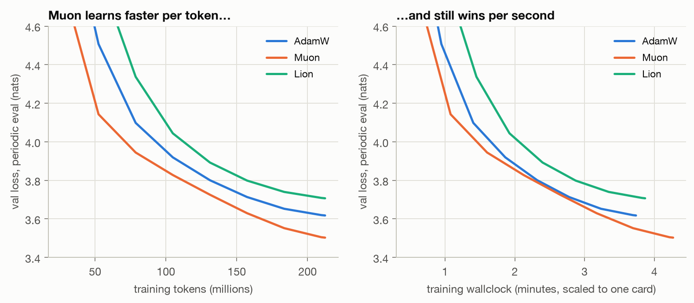
*Figure 9. Periodic validation loss against training tokens (left) and against wallclock,
scaled to one card (right).*

### 4.8 Scaling law

A width ladder at 6 layers, d ∈ {128, 192, 256, 384, 512}, at about 20 tokens per parameter
(16× in N, 124× in compute), each width with its own LR sweep and three seeds, fits
(Figure 10):

**L(N) = 151 · N^(−0.299) + 2.41**, with **α = 0.299 [0.257, 0.354]** and **E = 2.41
[2.17, 2.63]** (95% CIs from 2,000 bootstrap resamples over seeds).

- N and D grow together here, so α blends the separate N and D exponents (Chinchilla's 0.34
  and 0.28). It is not comparable to Kaplan's data-unlimited α_N ≈ 0.076. The fit stayed
  inside my preregistered range.
- The best LR falls with width (8e-3 → 4e-3), as predicted.
- The RoPE family's exponent is half as large (0.15), so the two curves converge with scale.

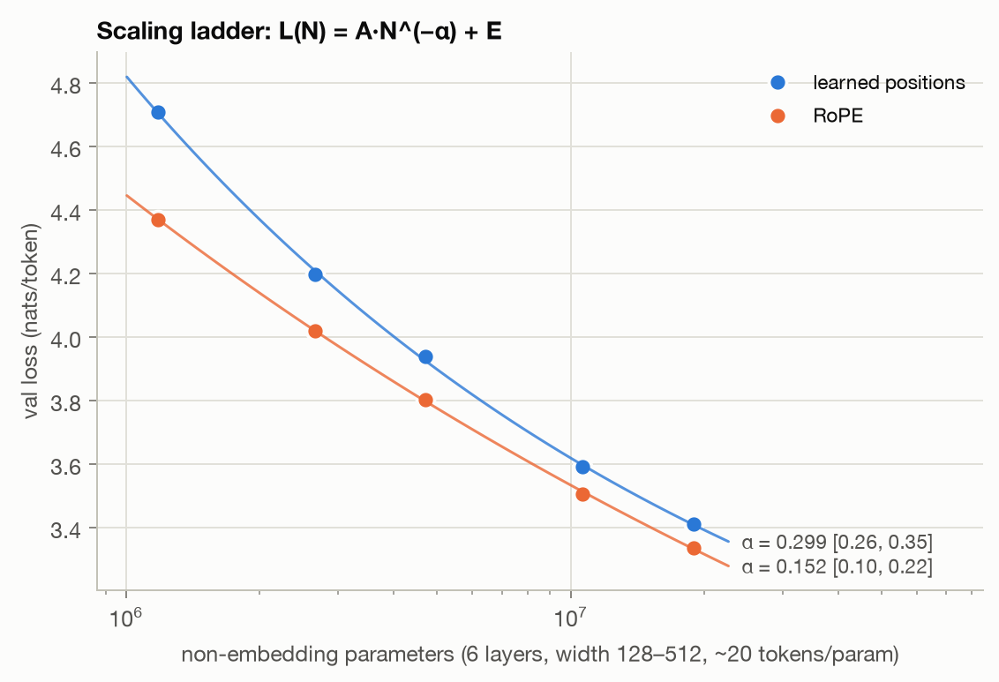
*Figure 10. Each width's 3-seed mean at its best LR, with the fitted curves.*

### 4.9 Does RoPE's advantage survive scale?

Tier A's clearest effect, re-measured at every width (Figure 11):

| Non-embedding params | 1.2M | 2.7M | 4.7M | 10.6M | 18.9M |
|---|---|---|---|---|---|
| RoPE − learned (nats) | −0.337 | −0.177 | −0.138 | −0.084 | −0.074 |

**RoPE is better at every width, by 10–47× 2σ, but the advantage shrinks monotonically**,
about as N^(−0.55): 4.5× smaller over 16× in N. The last step slows (−0.084 → −0.074), so
these points cannot tell whether the gap closes or levels off at larger scale. That is
exactly the limit of small-scale ablations Narang et al. warn about. A conclusion drawn only
at the smallest model would have overstated RoPE's benefit fourfold.

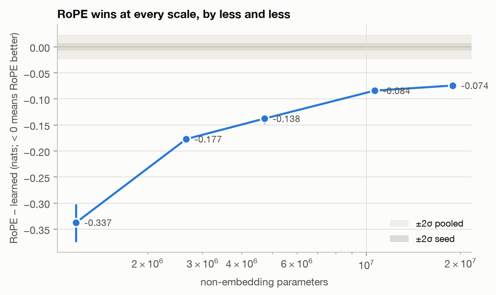
*Figure 11. The RoPE gap with 95% bootstrap CIs; bands are the unit-scale noise floor.*

### 4.10 When do induction heads form? (exploratory)

*This analysis was not preregistered.*

I probed all 70 kept checkpoints (steps 25 to 1,620) of the baseline and of the three depth
variants, three seeds each, with repeated random tokens (Olsson et al., 2022). The measure is
the best head's prefix-matching score: attention from a repeated token to the token that
followed its first occurrence.

- **Steps 25–200:** no induction anywhere (score ≤ 0.01).
- **Step 400:** the first signal appears, in the 2-layer model only (0.05–0.13; every deeper
  run is ≤ 0.04).
- **Step 800:** induction heads are present at **every depth** (0.32–0.49).

So they form between 52M and 105M tokens, a quarter to half-way through training.

**Depth does not move the formation window** at this resolution (checkpoints a factor of two
apart), **but it changes what happens afterwards.** The 2-layer model plateaus at 0.42–0.47.
The 12- and 24-layer models keep strengthening (0.54–0.67) and copy far better (Figure 6).

**I find no loss "bump" at formation.** Across steps 400–800, no run's training loss jumps by
more than 0.09 between steps, which is ordinary step-to-step noise. The large spikes in the
12- and 24-layer runs (up to +1.26 nats in one step) come at steps 142–174, late in warmup
as their LR rises through 0.006–0.007, well before any induction signal. They are optimization
instability, not a phase change. A finer checkpoint grid between steps 200 and 800 is the
obvious follow-up.

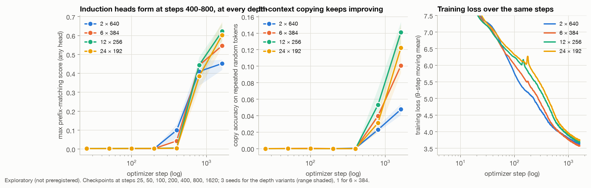
*Figure 12. The induction probe at each kept checkpoint (left, centre) and the training loss
over the same steps (right). Exploratory; 3 seeds per depth variant, 1 for 6 × 384.*

## 5. Negative and null results

At this scale, the following did **not** beat the vanilla baseline by a margin that clears
both noise estimates, or made things worse. This list is deliberately long.

- **NoPE** is far worse in distribution (+0.129) and extrapolates worst at 4,096.
- **Fixed sinusoidal positions** are worse than learned ones, even rescaled (+0.047). Unscaled,
  they are catastrophic (§7).
- **Gated FFNs (SwiGLU, GEGLU) and ReLU²** are threshold-sensitive (−0.013 to −0.022): small,
  and not separable from one another.
- **RMSNorm** is no different from LayerNorm (−0.002).
- **Decaying the LR to zero** gives nothing (linear −0.004) or slightly hurts (cosine +0.011).
- **Post-LN** collapses under GPT-2 initialization. Under standard initialization it trains
  but is 0.21 behind pre-LN.
- **PyTorch's standard initialization** is worse than GPT-2's for pre-LN (+0.054) and 12×
  noisier across seeds.
- **Any depth other than 6 layers** is worse at this size, under every matching.
- **Lion** is worse than AdamW (+0.089), with the tuning caveat in §4.7.
- **Small vocabularies** (2k, 4k) are worse in bits per byte, despite looking best per token.
- **RoPE's and ALiBi's in-distribution gains** do not carry over to code.

## 6. Where I was wrong

Every numeric prediction, scored against its own preregistered range:

| Preregistration | Held | Total |
|---|---|---|
| 001 noise floor | 2 | 3 |
| 002 positional encoding (incl. extrapolation) | 5 | 10 |
| 003 FFN | 3 | 4 |
| 004 normalization (incl. amendment and demo) | 7 | 13 |
| 005 schedules | 2 | 5 |
| 006 depth vs. width | 4 | 6 |
| 007 vocabulary | 1 | 5 |
| 008 optimizers | 2 | 5 |
| 009 scaling + cross-scale | 6 | 8 |
| **All** | **32** | **59** |

The misses fall into three patterns:
1. **I underestimated effect sizes at 10M** by 3–5× for positional encoding, Muon, and the
   smallest-model RoPE gap. Effects reported at 100M+ scale are a poor prior for 10M.
2. **Literature priors failed**: a broad depth optimum, decay to zero beating 10%, WSD ≈
   cosine, and a small optimal vocabulary.
3. **I misjudged noise**: σ_seed came in *below* my range, while the variant-to-variant spread
   came in far above anything I had planned for.

## 7. Deviations from the preregistered plan

Each change below was made before the runs it affects, and is dated in the relevant
preregistration. The exception is the pooled-σ change for Tier A, which was made after
seeing results and is reported both ways.

- **GPU kernel non-determinism (001).** Same-seed runs are not identical on the GPU. Two
  same-seed repeats were added to the noise-floor experiment to measure σ_kernel separately,
  and resumption was validated against the kernel-noise envelope rather than bitwise. A
  resumed run stays as close to an uninterrupted one as a fresh same-seed repeat does.
- **The sinusoid's scale (002).** The raw sin/cos table (RMS 0.71) drowned token embeddings
  initialized at 0.02. That configuration is reported as run (5.06–6.23 nats). A table
  rescaled to the learned table's starting magnitude was added as the test of fixed
  sinusoidal positions.
- **Post-LN and initialization (004).** Post-LN's collapse under GPT-2 initialization was
  traced to the initialization itself: this implementation matches PyTorch's
  `nn.TransformerEncoderLayer` exactly under the same init. That changed two things:
  - the design became a 2 × 2 of norm placement × initialization;
  - the warmup demonstration moved into post-LN's trainable LR range. The originally
    preregistered demonstration was never run.
- **Wallclock normalization across cards (006, 008).** Baseline training time is scaled by
  the benchmark ratio of the cards involved.
- **The pooled σ (shared rule 3).** As written, one unstable variant (the raw sinusoid, seed
  spread 0.28) made σ_pooled 0.062, which turned almost every verdict into
  "threshold-sensitive".
  - **For Tier A, post hoc:** variants with any run more than 0.5 nats worse than the
    baseline, already labelled unstable by rule, are excluded from the pool. Both versions of
    the verdicts are reported in the preregistrations.
  - **From Tier B on**, this exclusion was preregistered.
- **Scope of comparisons.** Scaling-ladder points are compared only within the ladder, never
  against the unit-scale baseline. Variants with a different tokenizer are compared only in
  bits per byte.

## 8. Limitations

- **Scale.** 1.2M–18.9M parameters, about 20 tokens per parameter, one corpus, English, one
  training context (512). §4.9 shows directly that effect sizes change with scale. Narang et
  al. (2021) and Tay et al. (2022) warn that conclusions from this regime may not transfer,
  and these results should be read that way.
- **Three seeds per variant.** That gives coarse per-variant noise. The pooled estimate helps
  but assumes a common variance, which Figure 14 shows is false.
- **Three LR points 2× apart, one edge extension.** Narrow-optimum methods (Lion,
  post-LN) may be under-tuned. Muon's AdamW part stayed at the baseline LR.
- **Confounds.** Depth is confounded with head count, and the 12-layer model has 11% fewer
  parameters. The vocab variants change depth by design.
- **Hardware.** Two RTX 4090 variants (24 GB and 48 GB) were used. Loss comparisons share
  kernels and their noise; wallclock comparisons are benchmark-normalized.
- **Evaluation.** Periodic evals use the first 1M validation tokens, so matched-FLOP and
  matched-wallclock comparisons inherit that subset's noise. Final evals use the full 10.2M tokens. The
  induction probe is synthetic.

## 9. Reproduction

Every result regenerates from the frozen data and the configs, on one CUDA GPU:

```bash
pip install -e ".[data,dev]" && pytest                    # 113 tests
bash experiments/prepare_data.sh                           # download, tokenizers, frozen data
bash experiments/protocol/00_validation.sh                 # throughput, resume determinism
bash experiments/protocol/01_noise_floor.sh                # 001
bash experiments/protocol/02_tier_a.sh                     # 002–006
bash experiments/protocol/03_tier_b_and_scaling.sh         # 007–009
python analysis/collect.py && python analysis/compare.py --exclude-unstable
python analysis/compare.py --exclude-unstable --metric val_iid_bpb
python analysis/tier_a_secondary.py && python analysis/scaling.py
python analysis/induction_timing.py && python analysis/figures.py
```

**Frozen data** (SHA-256 prefixes, from each `MANIFEST.json`):

| Vocab | Tokenizer | train | val_iid | val_long | val_ood |
|---|---|---|---|---|---|
| 8,192 | `7cb8d6a46f11f26e` | `a101f5ae9b99271e` (450M tokens) | `243828bcc985a6b3` | `0229a3d34bf7b749` | `5477e444f1be9bba` |
| 2,048 | `e5a28ad23e36a24a` | `c3a415924ca446f0` | `8589a849e3e61056` | `c11d8e34d2cbd66d` | `b767396b16583e12` |
| 4,096 | `35010798fe496356` | `1e361e185c1b1e89` | `ae18b1772176b872` | `2362e1d52be0703d` | `f1c28b0f24d3a963` |
| 16,384 | `6b61d85d945a38e5` | `0ca00c42cce3707f` | `ec5bb84a2b2ba033` | `805f7b3b2e9afca6` | `eb3fb926d1da3184` |

**Run identity.** A run's ID is a hash of every config field that can change the trained model,
plus the data hash. So "did I change only one thing?" is a mechanical check
(`python -m microlm.train.config A.yaml B.yaml`).

## Appendix

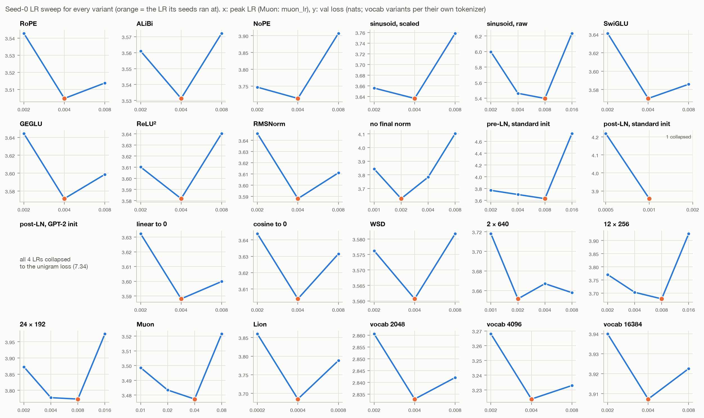
*Figure 13. The seed-0 LR sweep for every variant. Orange: the LR its other seeds ran at.*

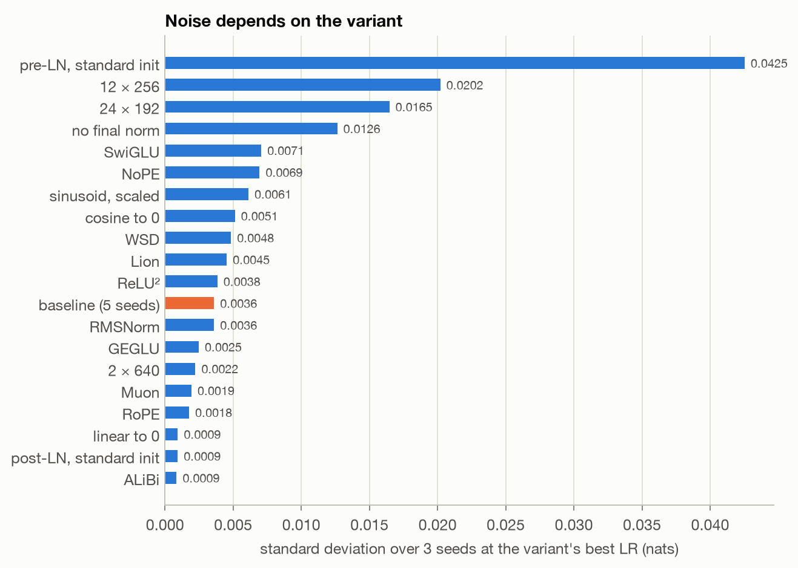
*Figure 14. Seed standard deviation at each variant's best LR. Noise depends on the variant.*

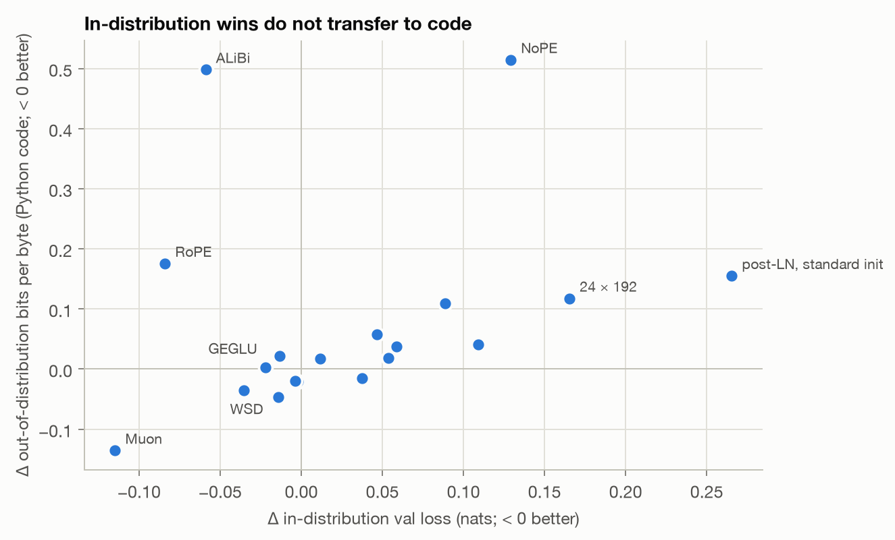
*Figure 15. In-distribution Δ against out-of-distribution Δ (Python code).*

## References

- Bergsma et al. (2025). Straight to Zero: Why Linearly Decaying the Learning Rate to Zero
  Works Best for LLMs.
- Chen et al. (2023). Symbolic Discovery of Optimization Algorithms (Lion).
- Hägele et al. (2024). Scaling Laws and Compute-Optimal Training Beyond Fixed Training
  Durations.
- Hoffmann et al. (2022). Training Compute-Optimal Large Language Models.
- Jordan et al. (2024). Muon: an optimizer for hidden layers in neural networks.
- Kaplan et al. (2020). Scaling Laws for Neural Language Models.
- Kazemnejad et al. (2023). The Impact of Positional Encoding on Length Generalization in
  Transformers.
- Liu et al. (2020). Understanding the Difficulty of Training Transformers.
- Narang et al. (2021). Do Transformer Modifications Transfer Across Implementations and
  Applications?
- Olsson et al. (2022). In-context Learning and Induction Heads.
- Press et al. (2021). Train Short, Test Long: Attention with Linear Biases.
- Shazeer (2020). GLU Variants Improve Transformer.
- So et al. (2021). Primer: Searching for Efficient Transformers for Language Modeling.
- Su et al. (2021). RoFormer: Enhanced Transformer with Rotary Position Embedding.
- Summers & Dinneen (2021). Nondeterminism and Instability in Neural Network Optimization.
- Tay et al. (2022). Scaling Laws vs Model Architectures.
- Xiong et al. (2020). On Layer Normalization in the Transformer Architecture.
